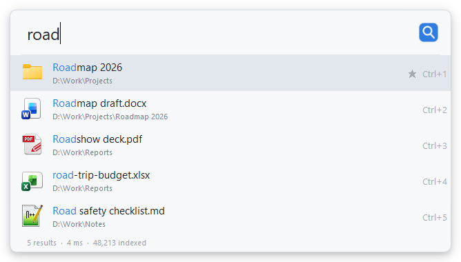
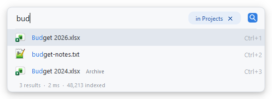
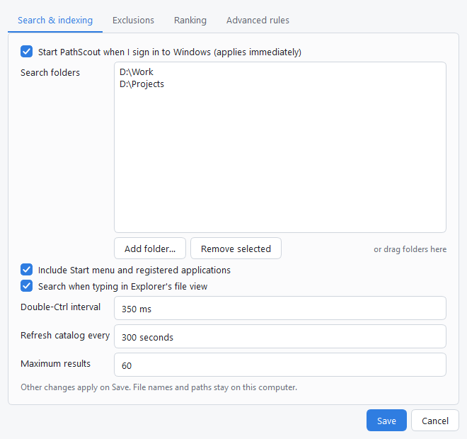
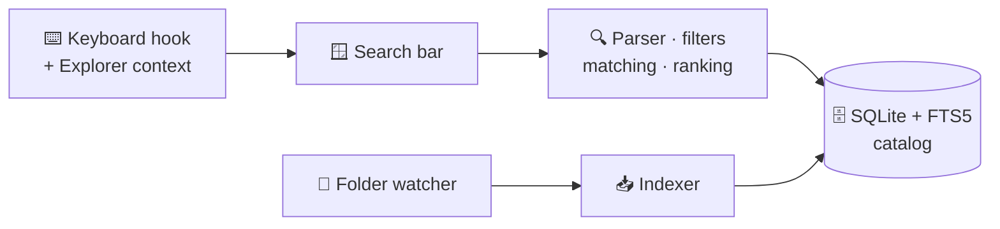

<div align="center">


# PathScout

**Double-tap <kbd>Ctrl</kbd>. Type a few letters. Open anything.**

A fast, private launcher for Windows that finds your apps, files and folders —<br>
or searches the folder you are in when you simply start typing in Explorer.

[](#-requirements)
[](https://www.python.org/)
[](https://doc.qt.io/qtforpython-6/)
[](https://www.sqlite.org/fts5.html)
[](#-privacy)
[](https://docs.astral.sh/ruff/)
[](LICENSE)



</div>

---

## ✨ Highlights

| | |
| --- | --- |
| ⚡ **Instant launcher** | Double-tap <kbd>Ctrl</kbd> or press <kbd>Ctrl</kbd>+<kbd>Alt</kbd>+<kbd>Space</kbd> anywhere. A compact bar opens; results appear as you type. |
| 📂 **Type-to-search in Explorer** | Start typing in an Explorer file list and a slim bar docks to that window, searching the folder you are in — its own entries first. |
| 🧠 **Smart matching** | Exact, prefix, word starts, camelCase initials (`vsc` → *Visual Studio Code*) and fuzzy subsequences, with matched letters highlighted. |
| 📈 **Learns what you open** | Launches per query, favorites and recency lift the results you actually use. |
| 🎯 **Rich query language** | `type:`, `ext:`, `in:`, `path:`, `name:`, dates, sorting, `!exclusions` and more. |
| 🚫 **Clean results by default** | Skips `.git*`, caches (`__pycache__`, `.ruff_cache`, `.mypy_cache`, …), virtual environments under any name, `node_modules`, `build`, `dist`, Gradle folders and folders marked with `.nobackup`. |
| 🔄 **Always current** | Watches your folders live; file changes refresh exactly that file, folder changes only their subtree. |
| ⌨️ **Keyboard first** | <kbd>Enter</kbd> opens, <kbd>Ctrl</kbd>+<kbd>1</kbd>…<kbd>9</kbd> opens a numbered result, <kbd>Ctrl</kbd>+<kbd>Enter</kbd> shows it in its folder. |
| 🔒 **Private** | No telemetry, no network service, no file contents read. Everything stays in `%LOCALAPPDATA%\PathScout`. |
| ⬆️ **Self-updating** | Running from a git checkout? PathScout notices new commits and updates with one click. |

<div align="center">

</div>

## 🚀 Quick start

```powershell
git clone https://github.com/<owner>/pathscout.git
cd pathscout
python -m venv .venv
.\.venv\Scripts\python.exe -m pip install -e .
.\.venv\Scripts\python.exe -m pathscout
```

Afterwards, start it without a console window:

```powershell
.\Start-PathScout.ps1               # open the search bar
.\Start-PathScout.ps1 -Background   # start quietly in the tray
```

PathScout starts with your Desktop, Documents and Downloads plus installed
applications. Add your work folders in **Settings → Search & indexing** — or just
drag them from Explorer into the list. The first scan runs in the background.

Tick **Start with Windows** in the tray menu or in Settings to launch PathScout at
sign-in. It manages only its own shortcut in your Startup folder.

### 📋 Requirements

- Windows 10 or 11
- Python 3.11 or newer with SQLite FTS5 (the standard python.org and Conda builds)
- An ordinary user account — no administrator rights, services or drivers

## ⌨️ Keyboard

| Keys | Action |
| --- | --- |
| <kbd>Ctrl</kbd> <kbd>Ctrl</kbd> | Show or hide the search bar |
| <kbd>Ctrl</kbd>+<kbd>Alt</kbd>+<kbd>Space</kbd> | Alternative global shortcut |
| Typing in Explorer | Search the current folder and everything below it |
| <kbd>↑</kbd> <kbd>↓</kbd> | Select a result |
| <kbd>Enter</kbd> | Open the selected result |
| <kbd>Ctrl</kbd>+<kbd>1</kbd> … <kbd>Ctrl</kbd>+<kbd>9</kbd> | Open the numbered result |
| <kbd>Ctrl</kbd>+<kbd>Enter</kbd> | Show the result in its folder |
| <kbd>Ctrl</kbd>+<kbd>Shift</kbd>+<kbd>C</kbd> | Copy the path |
| <kbd>Ctrl</kbd>+<kbd>D</kbd> | Toggle favorite |
| <kbd>Ctrl</kbd>+<kbd>L</kbd> | Select the query |
| <kbd>Ctrl</kbd>+<kbd>,</kbd> | Settings |
| <kbd>Shift</kbd>+<kbd>F10</kbd> / right-click | Open, reveal, copy, favorite, exclude |
| <kbd>Esc</kbd> | Hide (indexing keeps running in the tray) |

Click the icon at the right of the bar for the **All / Apps / Files / Folders**
filters, refresh, an expanded view, settings, About and restart. Right-click a
result → **Exclude this or a parent folder…** to drop a noisy folder tree; the
picker shows how many catalog entries each choice removes.

## 🔍 Query language

```text
report                                  name or path contains "report"
vsc type:app                            initials of an application
report ext:pdf,docx                     only these extensions
budget in:"D:\Work Projects"            inside this folder
path:projects/reports name:annual       ordered parent folders, name only
report after:2025-06-01 before:2025-06-30 sort:modified
report !archive                         exclude paths containing "archive"
report match:keyword score:match        no fuzzy matching, text relevance only
report low:true                         include low-priority results
```

| Filter | Meaning |
| --- | --- |
| `type:file` · `type:folder` · `type:app` | Item kind |
| `ext:pdf,txt` | Extensions (repeatable) |
| `in:"C:\Folder"` | Descendants of an absolute folder |
| `path:a/b` | Parent folders in this order (repeatable) |
| `name:text` | Match the file name without extension |
| `!text` | Reject paths containing `text` |
| `match:keyword` · `match:fuzzy` | Matching style (default fuzzy) |
| `sort:score` · `sort:name` · `sort:modified` | Order (default score) |
| `score:combined` · `score:match` | With or without personal ranking |
| `after:YYYY-MM-DD` · `before:YYYY-MM-DD` | Modification date range, inclusive |
| `low:true` | Show low-priority results alongside the others |

Quoted text keeps spaces, apostrophes are literal and Windows paths such as
`C:\Work` stay ordinary search text. The full contract is in the
[behavior specification](docs/specification.md).

## 🎛️ Exclusions and priorities

**Settings → Exclusions** takes absolute folders (drag & drop works), folder-name
patterns with `*`, `?` and `[…]` wildcards, and marker file names. Defaults:

- **Markers:** `.nobackup`, `.no-backup`, `pyvenv.cfg` (Python environments) and
  `conda-meta` (Conda environments) exclude their folder and everything below it.
- **Folder names:** `.git*`, `.svn`, `.hg`, `__pycache__`, `.venv`, `venv`,
  `.ruff_cache`, `.mypy_cache`, `.pytest_cache`, `.tox`, `.nox`, `.hypothesis`,
  `.ipynb_checkpoints`, `.eggs`, `*.egg-info`, `node_modules`, `.next`,
  `.parcel-cache`, `build`, `dist`, `.gradle`, `.cxx`, `.externalNativeBuild`,
  `.vs`, `.idea`, `$Recycle.Bin`, `System Volume Information`.

Patterns match whole folder names, so `buildings` stays searchable.

**Settings → Ranking** boosts or demotes folders, one rule per line:

```text
25  | D:\Projects | high
-20 | D:\Archive  | low
0   | D:\Private  | ignored
```

**Advanced rules** add filename-regex, extension and Windows-attribute rules.
`ignored` hides an item completely, `low` makes it a fallback, `high` lifts it to
the top group; the number fine-tunes the order.

<div align="center">

</div>

## 🔒 Privacy

- 🏠 Runs entirely on your computer. No account, telemetry or cloud service.
- 📄 Indexes names and metadata only — never file contents.
- 🗂️ Settings, catalog, favorites, history and logs live in `%LOCALAPPDATA%\PathScout`
  and contain your paths and queries; treat that folder like other personal data.
- 🧹 **Clear search history** in the tray forgets launches but keeps favorites.

## 🛠️ Command line

```powershell
python -m pathscout                         # open the search bar
python -m pathscout --background            # start in the tray
python -m pathscout --no-hooks              # no global shortcuts or Explorer typing
python -m pathscout --data-dir D:\Temp\Try  # separate settings and catalog
python -m pathscout --version
```

Starting PathScout again shows the running instance. A second `--background`
start leaves it alone.

## 🧩 How it works



Scans are staged and published atomically, so a cancelled or failed scan never
empties the catalog. Unreadable folders keep their previous entries while the rest
refreshes. Each search runs in the background and is cancelled as soon as you type
on. Read the [architecture notes](docs/architecture.md) for the details.

## 🧪 Development

```powershell
python -m unittest discover -s tests -v          # unit, UI and integration tests
python tools\smoke_test.py --native              # real Qt flow + hook attach/detach
python tools\benchmark.py --entries 50000        # synthetic search benchmark
python -m ruff check pathscout tests tools
python -m ruff format --check pathscout tests tools
```

Tests use temporary catalogs, folders and git repositories; they never touch your
real settings, Startup folder or files.

📚 [Architecture](docs/architecture.md) ·
[Specification](docs/specification.md) ·
[Validation](docs/validation.md) ·
[Engineering review](docs/review.md) ·
[Third-party notices](THIRD_PARTY_NOTICES.md)

## ⚠️ Limitations

- Windows only: the keyboard hook, Explorer integration, folder watching and
  autostart use Windows APIs.
- Indexes by walking folders and watching changes, not by reading the NTFS
  journal; very large drive-wide catalogs build slower, and one-letter searches
  over tens of thousands of items take around a second.
- Input methods (IME), Windows 11 tab edge cases, high-DPI multi-monitor setups and
  screen readers still need more real-world testing.

## 📄 License

[MIT](LICENSE) © PathScout contributors. Dependencies keep their own licenses — see
[third-party notices](THIRD_PARTY_NOTICES.md).
