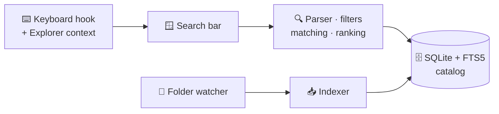

<div align="center">


# PathScout

**Double-tap <kbd>Ctrl</kbd>. Type a few letters. Open anything.**

A fast, private launcher for Windows that finds your apps, files and folders —<br>
or searches the folder you are in when you simply start typing in Explorer.

[](#-requirements)
[](https://www.python.org/)
[](https://doc.qt.io/qtforpython-6/)
[](https://www.sqlite.org/fts5.html)
[](#-privacy)
[](https://docs.astral.sh/ruff/)
[](LICENSE)


</div>

---

## ✨ Highlights

| | |
| --- | --- |
| ⚡ **Instant launcher** | Double-tap <kbd>Ctrl</kbd> or press <kbd>Ctrl</kbd>+<kbd>Alt</kbd>+<kbd>Space</kbd> anywhere. A compact bar opens; results appear as you type. |
| 📂 **Type-to-search in Explorer** | Start typing in an Explorer file list and a slim bar docks to that window, searching the folder you are in — its own entries first. |
| 🧠 **Smart matching** | Exact, prefix, word starts, camelCase initials (`vsc` → *Visual Studio Code*) and fuzzy subsequences, with matched letters highlighted. |
| 📈 **Learns what you open** | Launches per query, favorites and recency lift the results you actually use. |
| 🎯 **Rich query language** | `type:`, `ext:`, `in:`, `path:`, `name:`, dates, sorting, `!exclusions` and more. |
| 🚫 **Clean results by default** | Skips `.git*`, caches (`__pycache__`, `.ruff_cache`, `.mypy_cache`, …), virtual environments under any name, `node_modules`, `build`, `dist`, Gradle folders and folders marked with `.nobackup`. |
| 🔄 **Always current** | Watches your folders live; file changes refresh exactly that file, folder changes only their subtree. |
| ⌨️ **Keyboard first** | <kbd>Enter</kbd> opens, <kbd>Ctrl</kbd>+<kbd>1</kbd>…<kbd>9</kbd> opens a numbered result, <kbd>Ctrl</kbd>+<kbd>Enter</kbd> shows it in its folder. |
| 🔒 **Private** | No telemetry or network service. Content searches read files locally on demand. Everything stays in `%USERPROFILE%\.PathScout`. |
| ⬆️ **Self-updating** | Running from a git checkout? PathScout notices new commits and updates with one click. |

<div align="center">

</div>

Typing in Explorer opens a compact completion bar. Matching direct folders come
first, followed by direct files; only when there are no direct matches does it
search the catalog below that folder. Direct folder names are read live, including
folders containing `.nobackup` or `.no-backup`; their contents stay excluded from
indexing and recursive search. Clicking a folder or pressing Enter navigates the
original Explorer tab, without opening another window. Clearing the scope returns
to the global launcher.

## 🚀 Quick start

```powershell
git clone https://github.com/bjspi/PathScout.git
cd PathScout
python -m venv .venv
.\.venv\Scripts\python.exe -m pip install -e .
.\.venv\Scripts\python.exe -m pathscout
```

Afterwards, start it without a console window:

```powershell
.\Start-PathScout.ps1               # start quietly in the tray
.\Start-PathScout.ps1 -Show         # start and open the search bar
```

PathScout starts with your Desktop, Documents and Downloads plus installed
applications. Add your work folders in **Settings → Search & indexing** — or just
drag them from Explorer into the list. The first scan runs in the background.

Tick **Start with Windows** in the tray menu or in Settings to launch PathScout at
sign-in. It manages only its own shortcut in your Startup folder.

### 📋 Requirements

- Windows 10 or 11
- Python 3.11 or newer with SQLite FTS5 (the standard python.org and Conda builds)
- An ordinary user account — no administrator rights, services or drivers

## ⌨️ Keyboard

| Keys | Action |
| --- | --- |
| <kbd>Ctrl</kbd> <kbd>Ctrl</kbd> | Show or hide the search bar |
| <kbd>Ctrl</kbd>+<kbd>Alt</kbd>+<kbd>Space</kbd> | Alternative global shortcut |
| Typing in Explorer | Complete direct folder/file names; search below only without a direct match |
| <kbd>↑</kbd> <kbd>↓</kbd> | Select a result |
| <kbd>Enter</kbd> | Open the selected result |
| <kbd>Ctrl</kbd>+<kbd>1</kbd> … <kbd>Ctrl</kbd>+<kbd>9</kbd> | Open the numbered result |
| <kbd>Ctrl</kbd>+<kbd>Enter</kbd> | Show the result in its folder |
| <kbd>Ctrl</kbd>+<kbd>Shift</kbd>+<kbd>C</kbd> | Copy the path |
| <kbd>Ctrl</kbd>+<kbd>D</kbd> | Toggle favorite |
| <kbd>Ctrl</kbd>+<kbd>L</kbd> | Select the query |
| <kbd>Ctrl</kbd>+<kbd>,</kbd> | Settings |
| <kbd>Shift</kbd>+<kbd>F10</kbd> / right-click | Open, reveal, copy, favorite, exclude |
| <kbd>Esc</kbd> | Hide (indexing keeps running in the tray) |

Click the icon at the right of the bar for the **All / Apps / Files / Folders**
filters, refresh, an expanded view, settings, About and restart. Right-click a
result → **Exclude this or a parent folder…** to drop a noisy folder tree; the
picker shows how many catalog entries each choice removes.

The three icons in the bottom bar restrict results to **Files / Folders / Apps**.
Click the selected icon again for **All**, or use **Alt+1 / Alt+2 / Alt+3** and
**Alt+0** for All. Typed `type:file`, `type:folder` (or `type:dir`) and `type:app` filters update
these buttons; choosing a button replaces any typed kind override.
Use `t:` as shorthand for `type:`, for example `t:dir`, `t:file` or `t:app`.

## 🔍 Query language

```text
report                                  name or path contains "report"
vsc type:app                            initials of an application
*.json                                 shell-style filename wildcard
report[0-9].json                        one digit in the filename
report ext:pdf,docx                     only these extensions
ext:doc,docx                           Word document extensions
ext:doc*                               any extension starting with doc
ext:(jpg,png)                          either extension; parentheses are optional
budget in:"D:\Work Projects"            inside this folder
path:projects/reports name:annual       ordered parent folders, name only
report after:2025-06-01 before:2025-06-30 sort:modified
size:>5mb size:<1gb                    files larger than 5 MB and smaller than 1 GB
report after:2026-02* before:2026-02*   reports modified during February 2026
report !archive                         exclude paths containing "archive"
report contains:"invoice number"        filter matching text files by their contents (Rust)
*.json contains:gsk_*                   fnmatch pattern within text contents (Rust)
*.json rg:gsk_*                         content: and rg: are aliases for contains:
report match:keyword score:match        no fuzzy matching, text relevance only
report low:true                         include low-priority results
%TEMP%                                 open the Windows temporary directory
%LOCALAPPDATA%                         open local application data
~/                                     list the user directory's direct children
~/.myagents                            open this folder even outside indexed roots
```

| Filter | Meaning |
| --- | --- |
| `type:file` · `type:folder` · `type:dir` · `type:app` | Item kind; `t:` is shorthand for `type:` |
| `ext:pdf,txt` · `ext:(jpg,png)` · `ext:doc*` | Extensions/patterns, combined with OR (repeatable) |
| `in:"C:\Folder"` | Descendants of an absolute folder |
| `path:a/b` | Parent folders in this order (repeatable) |
| `name:text` | Match the file name without extension |
| `!text` | Reject paths containing `text` |
| `match:keyword` · `match:fuzzy` | Matching style (default fuzzy) |
| `sort:score` · `sort:name` · `sort:modified` | Order (default score) |
| `score:combined` · `score:match` | With or without personal ranking |
| `after:YYYY-MM-DD` · `before:YYYY-MM-DD` | Modification date range, inclusive |
| `after:2026-` · `after:2026-02*` | From January 1 or February 1, 2026 |
| `before:2026-` · `before:2026-02*` | Through the end of 2026 or February 2026 |
| `size:>5kb` · `size:<2mb` | File/application size; also `>=` and `<=` |
| `contains:"some text"` · `contains:gsk_*` | Case-insensitive text/fnmatch content filter; Rust backend required |
| `content:text` · `rg:text` | Aliases for `contains:`, with identical fnmatch behavior |
| `low:true` | Show low-priority results alongside the others |

Quoted text keeps spaces, apostrophes are literal and Windows paths such as
`C:\Work` stay ordinary search text. The full contract is in the
[behavior specification](docs/specification.md).

Search terms support fnmatch patterns: `*`, `?`, `[abc]`, `[0-9]` and `[!0-9]`.
Patterns match the whole filename, including its extension; `name:` matches the
stem instead. Use `[[]` for a literal opening bracket. Patterns work inside
quotes, alongside ordinary fuzzy terms and with filters. `path:` accepts the
same patterns for individual parent folders; `!text` remains a literal exclusion.

Extension filters also accept fnmatch patterns. `ext:doc,docx` finds exactly those
extensions; `ext:doc*` also includes `docm` and other extensions starting with
`doc`. Lists accept optional parentheses and spaces inside them, such as
`ext:(jpg, png)` or `ext:(doc*, pdf)`. Repeated `ext:` filters add alternatives.

Size units are case-insensitive: `b`/`byte`, `kb`/`kbyte`/`KiB`, `mb`/`mbyte`,
`gb`/`gbyte` and `tb`/`tbyte` (plural `bytes` forms also work). Each step is 1024;
without a unit the value is bytes. Decimal points or commas work (`size:>1.5mb`),
and `size:> 5kb` is accepted. Repeated size filters intersect their bounds.
Folder sizes are not calculated. Partial dates accept a year or year-month,
optionally ending in `-` or `*`; `after:` starts the period and `before:` includes
its final day, using local time.
Size filters show approximate sizes on each result row; date filters show the
stored modification date. These labels use catalog metadata without reading
files while painting the UI.

`contains:` reads supported text files on demand after filename/path filters and
exclusions, before the final result limit. It builds no content index and runs on
the search worker with cancellation. JSON, Markdown, TXT, logs, CSV, configuration
and common source-code files are supported, including UTF-8 and BOM-marked UTF-16.
Binary data, Office documents, PDFs, offline files and files over 64 MiB are
skipped; unreadable or deleted files also do not match. PDFs with a text layer
would require a separate text extractor; image-only PDFs would additionally need
OCR. Narrow the filename, extension or folder first for large collections.

**Settings → Search & indexing → Content search threads (Rust)** sets how many
files are scanned concurrently (1–16, default 4). This applies to `contains:`,
`content:` and `rg:`; filename search still uses the catalog. The backend uses
ripgrep libraries directly, with reusable workers and no per-file processes.
Higher values can increase disk activity and memory use. Save applies the change
to the next search without rebuilding the catalog.

Content patterns match anywhere within a line and support `*`, `?`, `[0-9]` and
`[!0-9]`. They do not span lines. Regex punctuation such as `.` and `+` stays
literal; use `[*]`, `[?]` and `[[]` to search for literal wildcard characters.

Start with `%` to suggest known Windows directory variables (`%APPDATA%`,
`%USERPROFILE%` and others). A trailing `/` or `\` lists direct children;
`~/Doc` completes names below your user directory. These shortcuts work without
indexing that folder, run in the background and honor exclusions and markers.
`in:%USERPROFILE%` also expands variables when filtering the existing catalog.

## 🎛️ Exclusions and priorities

**Settings → Exclusions** takes absolute folders (drag & drop works), file/folder-name
patterns with `*`, `?` and `[…]` wildcards, and marker file names. Defaults:

- **Markers:** `.nobackup`, `.no-backup`, `pyvenv.cfg` (Python environments) and
  `conda-meta` (Conda environments) exclude their folder and everything below it.
- **Windows shortcuts:** `*.lnk` excludes shortcuts, including existing catalog results.
- **Office temporary files:** `~$*` excludes lock/owner files such as `~$Report.docx`.
- **Folder names:** `.git*`, `.svn`, `.hg`, `__pycache__`, `.venv`, `venv`,
  `.ruff_cache`, `.mypy_cache`, `.dmypy_cache`, `.pytype`, `.pyre`, `.pyright`,
  `.basedpyright`, `.pylint.d`, `.pylint_cache`, `.lint_cache`, `.pytest_cache`,
  `pytest-cache-files-*`, `.tox`, `.nox`, `.hypothesis`,
  `.ipynb_checkpoints`, `.eggs`, `*.egg-info`, `node_modules`, `.next`,
  `.parcel-cache`, `build`, `dist`, `.gradle`, `.cxx`, `.externalNativeBuild`,
  `.vs`, `.idea`, `$Recycle.Bin`, `System Volume Information`.

Patterns match whole names, so `buildings` stays searchable.

**Settings → Ranking** boosts or demotes folders, one rule per line:

```text
25  | D:\Projects | high
-20 | D:\Archive  | low
0   | D:\Private  | ignored
```

**Advanced rules** add filename-regex, extension and Windows-attribute rules.
`ignored` hides an item completely, `low` makes it a fallback, `high` lifts it to
the top group; the number fine-tunes the order.

<div align="center">

</div>

## 🔒 Privacy

- 🏠 Runs entirely on your computer. No account, telemetry or cloud service.
- 📄 Indexes names and metadata only — never file contents.
- 🗂️ Settings, catalog, favorites, history and logs live in `%USERPROFILE%\.PathScout`
- 📝 `settings.json` holds user preferences. `pathscout.log` rotates at 5 MB with five backups.
  Diagnostics record search timing, UI stalls, shortcut dispatch and focus owners
  (process names/PIDs, without query text or window titles). Log writes run in the background.
  Existing settings, favorites and history from `%LOCALAPPDATA%\PathScout` are copied
  on first start; originals are retained. Close an older running instance first.
  and contain your paths and queries; treat that folder like other personal data.
- 🧹 **Clear search history** in the tray forgets launches but keeps favorites.

## 🛠️ Command line

```powershell
python -m pathscout                         # start in the tray
python -m pathscout --show                  # start and open the search bar
python -m pathscout --no-hooks              # no global shortcuts or Explorer typing
python -m pathscout --data-dir D:\Temp\Try  # separate settings and catalog
python -m pathscout --version
```

PathScout starts quietly in the tray; press <kbd>Ctrl</kbd> <kbd>Ctrl</kbd> to search.
Starting it again opens the running instance's search bar, unless the second start
uses `--background`.

## 🧩 How it works



Scans are staged and published atomically, so a cancelled or failed scan never
empties the catalog. Unreadable folders keep their previous entries while the rest
refreshes. Each search runs in the background and is cancelled as soon as you type
on. Read the [architecture notes](docs/architecture.md) for the details.

## 🧪 Development

### Optional native acceleration

The separate `pathscout-native` package accelerates matching, ranking and SQLite
candidate reads. The normal Python installation needs no Rust dependencies and
continues to work when the extension is absent or incompatible.

Choose **Rust** (default, with Python fallback) or **Python** in
**Settings → Search & indexing → Search backend**. Save applies the choice to
the next search without rebuilding the catalog.

Use Python 3.12, Rust stable for `x86_64-pc-windows-msvc`, and Visual Studio Build
Tools with **Desktop development with C++**:

```powershell
python -m pip install maturin
python -m pip install ./native
python -c "import pathscout_native; print(pathscout_native.API_VERSION)"
# Rebuild after changing native sources or updating this checkout:
python -m pip install --force-reinstall ./native
# Build an abi3 wheel for distribution:
python -m maturin build --release --locked --manifest-path native/Cargo.toml --out dist
```

For diagnostics, `PATHSCOUT_SEARCH_ENGINE` overrides the saved preference:
`auto` selects native when available, `python` forces the reference engine,
and `native` requires a compatible extension.
Execution errors log once and retry the search in Python. Unicode tables currently
target Python's Unicode 15.0 (Python 3.12); other Unicode versions use Python.
Filename regex rules support a checked ASCII subset, including lookarounds and
backreferences. Unsupported regex syntax or applicable non-ASCII filenames also
use Python for the whole search.

For development in a virtual environment, `cd native; python -m maturin develop
--release` installs directly into that environment. Compare both native phases:

```powershell
python tools\benchmark.py --engine python --entries 50000 --directories 1000
python tools\benchmark.py --engine native --phase rows --entries 50000 --directories 1000
python tools\benchmark.py --engine native --phase sqlite --entries 50000 --directories 1000
cargo test --manifest-path native/Cargo.toml --locked
```

`PATHSCOUT_NATIVE_PHASE=rows` keeps SQLite reads in Python; the default `sqlite`
phase streams candidates in Rust.

```powershell
python -m unittest discover -s tests -v          # unit, UI and integration tests
python tools\smoke_test.py --native              # real Qt flow + hook attach/detach
python tools\benchmark.py --entries 50000        # synthetic search benchmark
python -m ruff check pathscout tests tools
python -m ruff format --check pathscout tests tools
```

Tests use temporary catalogs, folders and git repositories; they never touch your
real settings, Startup folder or files.

### GitHub builds and releases

[CI](https://github.com/bjspi/PathScout/actions/workflows/ci.yml) runs on pushes to
`main`, pull requests and manual dispatch. It checks Python style, Rust formatting
and Clippy, runs Windows tests without the extension and with both backends,
checks the Qt/keyboard flow, and builds the Python wheel/source distribution and
Windows x64 Rust wheel. Download them from the run's `pathscout-windows-packages` artifact.

Pushing a `v*` tag runs the same checks and publishes a GitHub Release only after
they pass, attaching those packages and a clean source ZIP. The tag must match
`pathscout/__init__.py`, `pyproject.toml`, `native/pyproject.toml` and
`native/Cargo.toml` (for example `v0.2.0`). Install both wheels from a release
with `python -m pip install <python-wheel> <native-wheel>` to enable Rust without
installing a compiler. Source ZIPs retain `native/` for local builds.

For example, publish version 0.2.0 from a clean, committed checkout with:

```powershell
git tag -a v0.2.0 -m "PathScout 0.2.0"
git push origin v0.2.0
```

The finished release appears under [Releases](https://github.com/bjspi/PathScout/releases).

📚 [Architecture](docs/architecture.md) ·
[Specification](docs/specification.md) ·
[Third-party notices](THIRD_PARTY_NOTICES.md)

## ⚠️ Limitations

- Windows only: the keyboard hook, Explorer integration, folder watching and
  autostart use Windows APIs.
- Indexes by walking folders and watching changes, not by reading the NTFS
  journal; very large drive-wide catalogs build slower. The Python engine takes
  around half a second for broad one-letter searches over 50,000 entries; optional
  native acceleration reduces that substantially.
- Input methods (IME), Windows 11 tab edge cases, high-DPI multi-monitor setups and
  screen readers still need more real-world testing.

## 📄 License

[MIT](LICENSE) © PathScout contributors. Dependencies keep their own licenses — see
[third-party notices](THIRD_PARTY_NOTICES.md).
