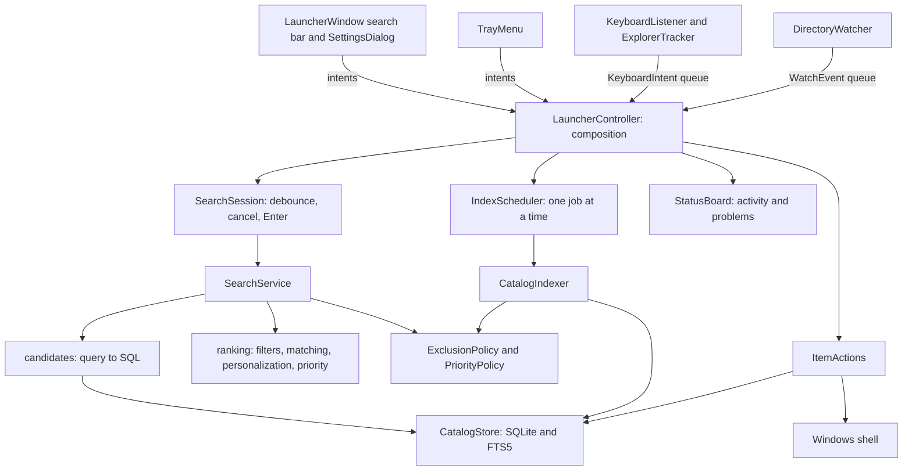

# Architecture

## Domain boundaries

PathScout is organized around catalog indexing, filesystem change monitoring,
query parsing, filtering, text matching, ranking, platform integration and UI state.
Value objects carry intent and policy; adapters own I/O. There is no service
locator, dependency-injection framework or shared database connection. The
controller composes the application explicitly.

| Module | Responsibility |
| --- | --- |
| `catalog/model.py` | Catalog values, `CatalogSource`, path identity (`path_key`) versus search normalization (`normalize`) |
| `catalog/exclusions.py` | Excluded paths, folder patterns and marker files, cached per operation |
| `catalog/priority.py` | Search classes (ignored/low/normal/high) and numeric boosts |
| `catalog/sources.py` | Which trees the catalog owns and which source owns a path |
| `catalog/indexer.py` | Scan policy, traversal, staging, reporting and publication decisions |
| `catalog/store.py` | SQLite schema and migration, staged snapshots, usage and favorites |
| `search/query.py` | The immutable parsed `SearchQuery` |
| `search/query_parser.py` | Tokenizing, recognized filters, value parsing and validation |
| `search/filters.py` | Structured eligibility: type, extension, scope, exclusions, dates |
| `search/matching.py` | Text match quality, ordered folder matching and fuzzy alignment |
| `search/ranking.py` | Eligibility, text relevance, personalization, configured priority, explanation |
| `search/candidates.py` | Query-to-SQL translation for the literal and fuzzy candidate passes |
| `search/service.py` | Streaming candidates into a bounded best-hits heap |
| `settings.py` | Validated settings value object and atomic JSON file |
| `actions.py` | Open, reveal and favorite use cases; only successful opens are learned |
| `platform/` | Win32 bindings, keyboard hook, Explorer COM, directory watching, shell, autostart |
| `ui/` | Search bar window, result icons and highlighting, settings, exclusion picker and About dialogs, tray, status, search session, index scheduler, git updater, worker delivery |
| `platform/git.py` | Read-only git queries for self-updating a source checkout |
| `__main__.py` | CLI, logging, crash logging, per-data-directory single instance and restart handover |

`catalog/` and `search/` do not import Qt or Win32. Their behavior is tested with
temporary SQLite catalogs and ordinary filesystem fixtures. The search package
translates queries into SQL itself (`candidates.py`), so the catalog store does not
depend on the query language.

## Catalog indexing

One scan is split along its responsibilities:

- `_EntryRules` decides whether an entry belongs in the catalog: links and offline
  folders, exclusions and ignored priorities. A scoped scan applies the same rules
  to every ancestor up to its source root (`allows_scope`). Disk errors propagate.
- `_ScanSession` walks directories. Entries stream from `os.scandir`; traversal
  state is a local pending-folder list. Each visit returns the subfolder to descend
  into, so no mutable state is passed through parameters.
- `_StagedRows` batches accepted items (500 per batch) into a private temporary table.
- `_ScanOutcome` records skips, error messages, paths whose old rows must survive,
  and unavailable sources.
- `CatalogIndexer` decides what a completed scan replaces: a full publication,
  one subtree, or an exact set of files.

A cancelled scan returns before publication, so the previous catalog stays
unchanged. An unreadable path keeps its previous rows while readable siblings still
refresh and delete. A wholly unavailable source keeps its previous snapshot. Index
marker probe failures preserve old rows; search fails closed on the same failure.
When an Explorer scope contains other configured sources, the scan keeps their
rows and indexing modes instead of taking ownership. An explicitly chosen root may
be a junction; links below a root are never followed.

WAL lets searches read while a scan stages. Each operation owns its SQLite
connection. Schema version 3 migrates versions 1 and 2 in one transaction, merging
alternate Windows path spellings without losing launches or favorites. Identity
uses absolute paths with nonexpanding uppercase mapping; search uses NFC/casefold.

## Search execution

`parse_query` collects tokens into a mutable draft; each recognized filter is one
assignment with its own value parser and user-facing error message. `build`
validates once and returns the frozen `SearchQuery`. Unknown `key:value` tokens and
Windows paths remain search text.

`read_candidates` builds SQL with `_SqlFilter`, which keeps every clause together
with its parameters. The literal pass uses FTS5 trigram matching for terms of three
or more characters and `LIKE` for shorter terms. The fuzzy pass matches
subsequences and excludes everything the literal pass returned. Both passes are
supersets of the domain matcher; `rank` makes the final decision:

1. Structured filters and ignored priority decide eligibility.
2. Ordered folder matching and per-term text matching decide text relevance.
3. Combined scoring adds bounded personalization and configured priority.
4. The priority band (promoted, normal, fallback) and an explanation are attached.

Ranking weights are named module constants. A `Ranker` prepares one query
(filters, scope identity, timestamp) and ranks many candidates. Candidates are
plain catalog rows with the stored normalized text; `Path` objects and hits are
created only for displayed results. `SearchService` streams candidates into a
bounded heap; once it is full, a candidate whose best possible sort key cannot
beat the weakest kept hit is skipped before text matching, and disk-based marker
checks run only for hits that would be kept. Empty default queries (optionally with a type filter) read only
learned items through the path identity index.

## Optional Rust search engine

`search/native_engine.py` selects `auto`, `python` or `native` through
`PATHSCOUT_SEARCH_ENGINE`. It checks `API_VERSION` and `UNICODE_VERSION`, prepares
one query/priority specification from the Python domain objects, and reconstructs
only the kept `Candidate`/`Ranking` objects. The Python loop remains the reference
and fallback. Missing or stale extensions and execution failures are logged once;
an explicit native request fails when no compatible module is available.

The separate `native/` maturin distribution exports `rank_rows` (Python-fetched
rows) and `rank_sqlite` (read-only SQLite, bundled FTS5, WAL, 15-second busy
timeout). Both share matching, priorities, ranking, bounds and a bounded heap.
`candidate_sql` remains the sole SQL builder. Literal and fuzzy statements are
combined with ordered `UNION ALL`, renamed named parameters and one heap; the
native SQLite reader holds one read transaction. No indexing or UI code moves.

Rust releases the GIL during ranking and SQLite reads. It reacquires it only for
the exclusion callback, after the same eligibility, bound and heap checks as
Python. Atomic cancellation is checked on every candidate and SQLite's progress
handler; a short-lived bridge forwards the existing Python `Event` every 5 ms.
Phase-one row conversion yields the GIL in batches. Cancellation returns no hits.

Unicode NFC is pinned to Unicode 15.0; generated full-casefold and character-class
tables come from the reference Python interpreter, with all-scalar checksum tests.
The Unicode version guard prevents a different interpreter database from silently
changing behavior. Sorting uses direct full casefold without NFC, as Python does.
Python-specific filename regex syntax and applicable non-ASCII filenames trigger
whole-search fallback; supported ASCII regexes use `fancy-regex`. Regex candidates
are preflighted before any exclusion callback, so fallback does not repeat disk
probes. Parity tests compare scores, bands, reasons, order and callback sequence
against the Python loop and exercise both extension entry points.

## Threads, scheduling and cancellation

Qt widgets live on the GUI thread. `BackgroundTasks` runs work on separate search
(2), index (1) and action (1) pools and always delivers results through a queued
signal to callbacks on the GUI thread. Callbacks never run inside `submit`.

`SearchSession` debounces typing, cancels the previous search, discards results of
abandoned searches by identity, and implements the Enter contract: Enter opens a
result of the query currently typed, waiting for its results when necessary.
Hidden windows do not rerun searches.

`IndexScheduler` runs one index job at a time. Pending work is prioritized: a full
scan, then the broadest dirty folder, then a batch of changed files. Repairs never
postpone the single-shot periodic full scan. While an Explorer-scoped session is
visible, full scans wait so its temporary snapshot survives. Changing indexing
settings cancels the running job, drops queued repairs and schedules a full scan.
UI-only settings restart nothing.

The keyboard listener thread runs a Windows message loop with a `WH_KEYBOARD_LL`
hook and the Ctrl+Alt+Space hotkey. Its callback reads a cached Explorer context
maintained by a separate COM apartment thread and queues `KeyboardIntent` values.

`DirectoryWatcher` threads own one directory handle, one event and one buffer.
`_PendingRead` guarantees that an overlapped `ReadDirectoryChangesW` call is
cancelled and acknowledged by the kernel before its buffer can be released.
Notification batches become `FileChange` (exact metadata refresh) or
`FolderChange` (subtree reconciliation). Overflow repairs the root. A failing watch
reports `WatchFailed` once, retries every 30 seconds, and reports `WatchRestored`
when it works again; the controller then repairs the whole root because changes
during the outage were never reported.

## Platform integration

PathScout uses an out-of-process low-level keyboard hook, pointer-sized ctypes
declarations, and `Shell.Application` to resolve a filesystem folder. It accepts
typing only in a recognized Explorer file view and never injects code into Explorer.
After a dead key, the next key stays with Explorer so accent composition is not broken.

`StartupShortcut` manages only `PathScout.lnk` in the user's Startup known folder.
The shortcut file is the source of truth for the tray and the settings dialog. It
starts `pythonw.exe` of the running environment with
`-m pathscout --background --data-dir <dir>`, quoted with `list2cmdline`, in the
directory that contains the `pathscout` package (a source checkout root or
site-packages). Shortcuts without PathScout's description and arguments are
reported as unrelated and never changed. COM objects are released before the
apartment is uninitialized.

A per-data-directory `QLockFile` elects one primary process before it opens a
user-restricted local server. A second foreground start asks the primary to show
the launcher; a second `--background` start only confirms it is running.
Unhandled exceptions in Qt slots and threads are written to `pathscout.log`.

## Operational choices

- Local metadata only; no file-content reads for search and no external service.
- Explicit roots rather than an automatic administrative whole-volume scan.
- SQLite/FTS5 rather than another database dependency.
- Qt Widgets via PySide6; Windows integration via ctypes and pywin32.
- No elevation, shell extension, service or scheduled task. Autostart is an
  ordinary per-user Startup shortcut created only on request.
- Original Python implementation and artwork.
